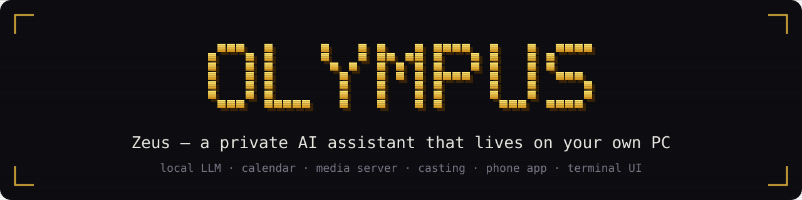
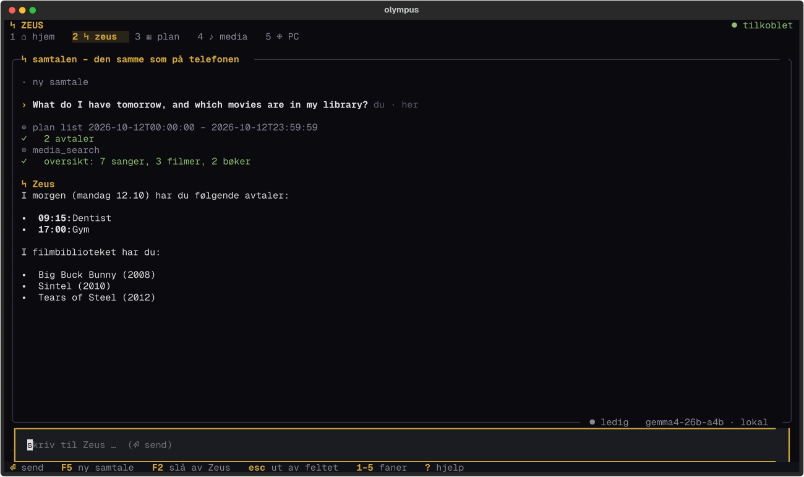
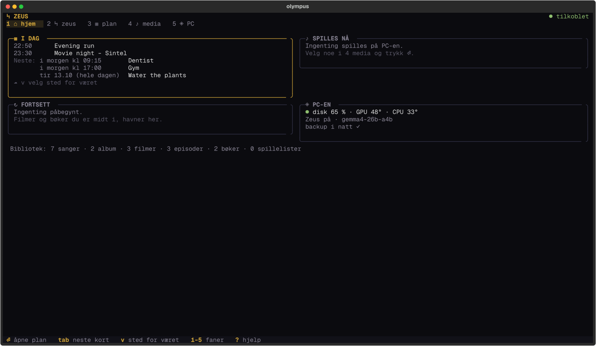
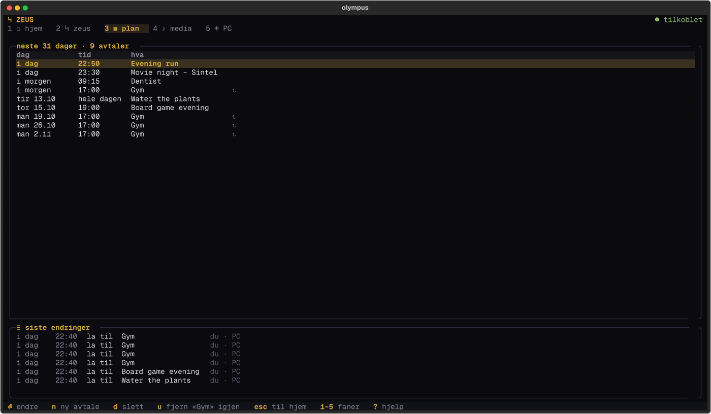
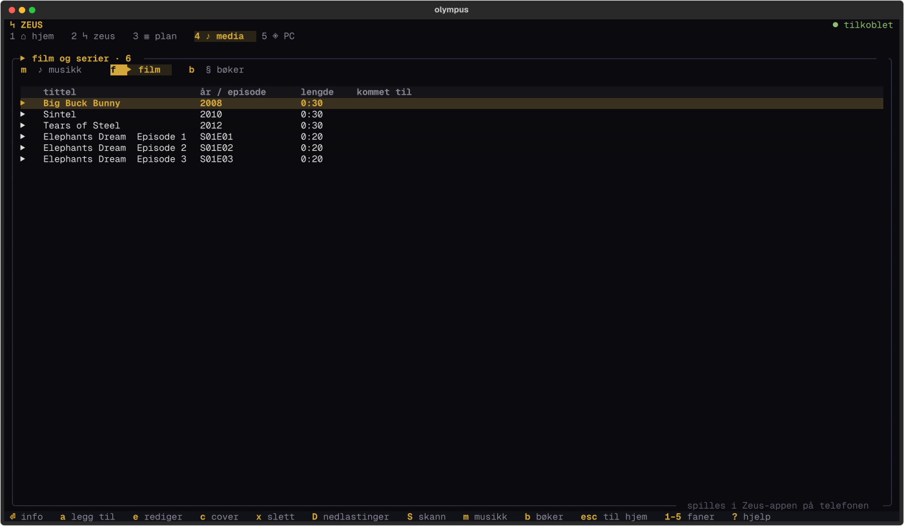
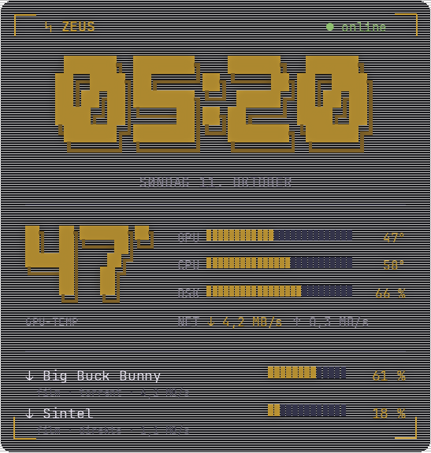
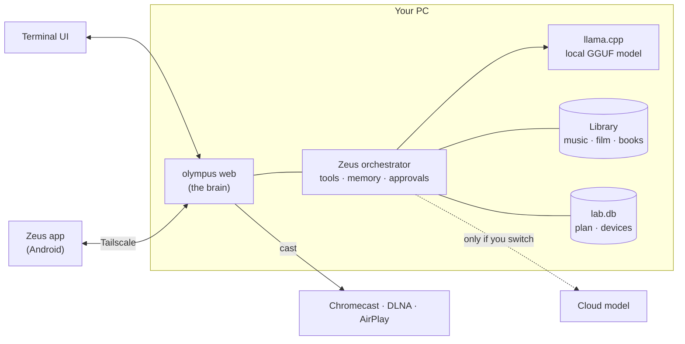

<p align="center"></p>

<p align="center">
  <a href="LICENSE"></a>
  
  
  
</p>

**Olympus** runs **Zeus**, a personal AI assistant, on your own computer. The "brain" (memory, tools, calendar,
media library, approvals) always stays on your PC. You only choose which model writes the replies: a **local
model on your GPU** (the default, nothing leaves the machine) or a cloud model when you decide to switch.

You can talk to Zeus from the terminal, from a full-screen terminal dashboard, or from the Android app over
Tailscale. They all share one conversation.

<p align="center"></p>

## What it does

| | |
|---|---|
| 🧠 **Local first** | Runs any GGUF model through [llama.cpp](https://github.com/ggml-org/llama.cpp) on AMD, NVIDIA, Intel or Apple GPUs, or on the CPU. Models load when you ask something and unload when idle. |
| 🛠 **Real tools, with approval** | Calendar, media library, web search, files, PC control (volume, lock, apps). Every change shows a preview and needs your OK, or can be undone instead. |
| 📅 **Calendar** | Shared between PC and phone, with repeating events, reminders, a morning brief and `.ics` export. |
| 🎬 **Media server** | Music, movies, TV shows, audiobooks and e-books from your own folders. Streams to the phone, or **casts to Chromecast, DLNA and AirPlay TVs** with direct play, remux or transcoding (up to 4K) and subtitles. |
| 📱 **Phone app** | Native Android app (Norwegian and English) with chat, voice, calendar, media player, e-book reader, widgets and notifications. It reaches your PC privately over Tailscale. |
| ☁ **Optional cloud** | Groq, Gemini, OpenRouter (free tiers) or your Claude Code subscription. Whenever a cloud model is active, the UI says so, and stricter approval rules apply. |
| 🔒 **One owner** | Built for a single person. Nothing is exposed to the internet by default, and phones pair with a one-time QR code. |

## Screenshots

<table>
  <tr>
    <td width="50%"><br><sub><b>Home</b>: today's plan, what's playing and machine status</sub></td>
    <td width="50%"><br><sub><b>Plan</b>: the next 31 days, plus who changed what</sub></td>
  </tr>
  <tr>
    <td width="50%"><br><sub><b>Media</b>: music, movies, shows and books</sub></td>
    <td width="50%" align="center"><br><sub><b>Android widget</b>: clock, GPU and CPU temperatures, downloads</sub></td>
  </tr>
</table>

<sub>All screenshots come from a demo instance with made-up events and open movies from the Blender Foundation.
The terminal UI and Zeus' replies are in Norwegian for now (see <a href="#language">Language</a>).</sub>

## Quick start

You need **Python 3.12+** and [uv](https://docs.astral.sh/uv/) (or pipx/pip).

```sh
uv tool install git+https://github.com/Thoaniel/olympus   # installs the `olympus` command
olympus setup                                           # llama.cpp + a model that fits your GPU + autostart
olympus                                                 # open the terminal UI
```

`olympus setup` does the platform-specific work for you:

1. It finds `llama-server` on your PATH. If there is none, it downloads the matching prebuilt
   [llama.cpp release](https://github.com/ggml-org/llama.cpp/releases) and verifies its checksum:
   - **Vulkan** on Linux and Windows (works with AMD, NVIDIA and Intel)
   - **CUDA** on Windows with NVIDIA
   - **Metal** on macOS
2. It suggests the largest model in the catalogue that fits your GPU memory. Nothing is downloaded until you
   say yes. If no model fits, you can use a cloud model.
3. Optionally, it starts the server at login using **systemd** (Linux), **launchd** (macOS) or
   **Task Scheduler** (Windows).

<details>
<summary><b>Linux</b></summary>

Works on any distribution. If your distro packages llama.cpp, you can install it first and `setup` will use it:

```sh
sudo pacman -S llama-cpp ggml-vulkan      # Arch
# or let `olympus setup` fetch the official build
```

Needs `ffmpeg` for casting and transcoding. Volume control uses `wpctl` or `pactl`.
</details>

<details>
<summary><b>Windows</b></summary>

```powershell
winget install astral-sh.uv Gyan.FFmpeg
uv tool install git+https://github.com/Thoaniel/olympus
olympus setup
```

With an NVIDIA card, `setup` picks the CUDA build together with its runtime libraries. Other GPUs get Vulkan.
Volume control is not supported on Windows yet.
</details>

<details>
<summary><b>macOS (Apple Silicon)</b></summary>

```sh
brew install uv ffmpeg llama.cpp
uv tool install git+https://github.com/Thoaniel/olympus
olympus setup
```

Unified memory counts as GPU memory when `setup` chooses a model.
</details>

<details>
<summary><b>Docker</b></summary>

```sh
cp docker-compose.yml my-compose.yml        # optional: edit media paths
docker compose up -d                        # AMD/Intel (Vulkan via /dev/dri) or CPU
docker compose -f docker-compose.yml -f docker-compose.nvidia.yml up -d   # NVIDIA
docker compose exec olympus olympus models pull <model-id>
```

The image is built on top of llama.cpp's official server image. Data lives in `./data`, and your media folders
are mounted read-write (set `MUSIC_DIR`, `MOVIES_DIR` and so on). The port is bound to `127.0.0.1` by default.
Use Tailscale to reach it from your phone.
</details>

## Everyday use

```sh
olympus                      # terminal UI: home, Zeus, plan, media, PC (keys 1–5, ? for help)
olympus "question"           # one-shot answer to stdout
olympus modell [id|lokal]    # show or switch the model Zeus answers with
olympus web                  # start the server for the phone app (prints a link and a QR code)
olympus pair                 # pair a phone (QR code, valid for 10 minutes)
olympus zeus                 # side window: what Zeus is doing, approvals, stop, AI on/off
olympus status               # live status: services, model, machine, downloads, phones
olympus models list|pull|rm  # manage local models
olympus auth login <provider># add a cloud key (groq, gemini, openrouter, tmdb, opensubtitles)
olympus doctor               # check GPU, VRAM, llama.cpp and models
```

## The phone app

The Android app lives in [`zeus-app/`](zeus-app). Build it with Android Studio, or run
`./gradlew assembleRelease` with your own signing key. Then:

1. Install [Tailscale](https://tailscale.com) on the PC and the phone.
2. Run `olympus pair` on the PC and scan the code in the app.

The app talks only to your own PC. There is no account, cloud relay or analytics.

## How it works



| Module | Responsibility |
|---|---|
| `web/server.py` | The brain: WebSocket and REST API for the app, the terminal UI and `olympus zeus` |
| `agents/orchestrator.py` | Zeus: the tool loop, approvals, memory, context compaction, "did it really do that?" check |
| `tools.py`, `actions.py` | The tools and their approval rules (stricter with a cloud model) |
| `model_manager.py` | Starts and stops `llama-server`, keeps within the VRAM budget, unloads when idle |
| `providers.py` | Local, OpenAI-compatible, Anthropic and Claude Code backends, with fallback |
| `medialib.py`, `cast.py` | Media library, e-book text, TV discovery and casting |
| `lab.py` | Calendar, paired devices and settings (SQLite) |
| `tui/` | Textual apps: the dashboard, `olympus zeus` and `olympus status` |

## Privacy and security

- **Local by default.** With a local model, nothing you say leaves the PC. When a cloud model is active, the
  status line says *"cloud – the conversation is sent out"*. Your long-term memory goes along by default. Set
  `memory.share_with_cloud = false` to keep it on the PC.
- **Approval for every change.** Tools that change something (calendar, files, PC, casting) show the exact
  preview first. After Zeus has read a web page, any tool that sends data out needs approval again, which guards
  against prompt injection.
- **Honesty check.** If a reply claims something was done ("added", "deleted") but no tool actually did it, the
  reply is thrown away and the model has to try again.
- **Small attack surface.** The server listens on localhost and on your Tailscale IP only. Phones pair with a
  QR code that expires after 10 minutes. API keys are stored in `~/.olympus/auth.json` with mode `600`.

## Configuration

All your data lives in `~/.olympus/` (set `OLYMPUS_HOME` to move it):

| File | What |
|---|---|
| `config.toml` | Only your overrides. The defaults ship with the package (`olympus config set <key> <value>`). |
| `SOUL.md`, `agents/zeus.md` | Zeus' personality and your own instructions |
| `theme.toml` | Colours |
| `memory/`, `sessions/` | Long-term memory and saved conversations |
| `lab.db`, `media.db` | Calendar, devices and media library |
| `models/` | GGUF files |

By default, media folders are found automatically (`~/Music`, `~/Videos/Movies`, `~/Videos/TV`, `~/Audiobooks`,
`~/Books` and their localized variants). To use your own paths, set `media_server.music_dir` and the other
`*_dir` keys.

## Language

The phone app follows your system language (Norwegian or English) and can be switched in its settings. The
terminal UI, the server's messages and Zeus' default personality are still **Norwegian**. Translations are
very welcome.

## Development

```sh
git clone https://github.com/Thoaniel/olympus && cd olympus
uv sync
uv run pytest            # uses a fake llama-server, so no GPU or model is needed
```

## License

[MIT](LICENSE)
